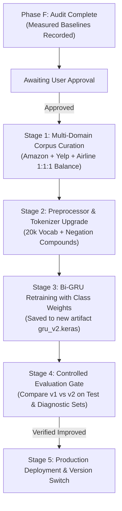

# KANSEI AI — Phase F: Sentiment Model Quality Audit & Improvement Plan

**Project:** KANSEI AI — Intelligent Sentiment Analyzer  
**Audit Date:** 2026-10-27  
**Scope:** Sentiment Model Quality, Dataset Integrity, Baseline Reproducibility, Customer Review Suitability, and Staged Improvement Roadmap  
**Status:** Audit Complete — Retraining & Model Modification Pending User Approval  

---

## Executive Summary

Phase E resolved batch UX and aggregated confidence telemetry in Analyzer Studio. Phase F investigates the predictive quality of the underlying sentiment models: the production **Keras Bidirectional GRU** (`backend/ml/artifacts/gru_model.keras`) and the baseline **TF-IDF + Logistic Regression** (`backend/ml/artifacts/baseline.joblib`).

### Key Findings
1. **Severe Training Domain Mismatch:** The current models were trained exclusively on the *Crowdflower Twitter US Airline Sentiment* dataset (`Tweets.csv`). Vocabulary is dominated by flight delays, cancellations, lost luggage, and airline customer support. Real-world customer reviews regarding hardware specifications, battery life, packaging, and software features suffer from Out-Of-Vocabulary (OOV) tokens and false positive/negative biases.
2. **Extreme Class Imbalance:** The dataset consists of **62.94% Negative**, **21.19% Neutral**, and **15.87% Positive**. Because 63% of samples are negative, the baseline model achieves 79.86% accuracy on the test set primarily by predicting "negative" on 94.13% of actual negative samples, while failing to detect 47.71% of neutral samples and 39.94% of positive samples.
3. **Preprocessing Discrepancy:** The GRU training and inference pipeline uses `clean_text` (HTML unescaping, mention removal, contraction expansion), whereas the baseline was trained on raw uncleaned text. When the baseline is evaluated with clean text, its accuracy drops from 79.86% to 76.77% and neutral recall collapses to 29.85%.
4. **Customer Review Diagnostic Failure:** When evaluated on a curated 25-sample diagnostic set of real-world product and service feedback:
   - **Bidirectional GRU accuracy: 40.0% (10/25)**
   - **Baseline Logistic Regression accuracy: 28.0% (7/25)**
   - Both models misclassified **80% of clearly positive reviews** as negative (e.g., *"The battery life is phenomenal and easily lasts two full days... Highly recommended!"* received a 90.72% negative prediction from GRU and 86.66% negative from LR).
   - The baseline classified **100% of factual neutral reviews as negative**.
   - Both models failed completely on mixed reviews (0%) and negation/sarcasm (20%).
5. **Confidence vs. Accuracy Decoupling:** Softmax confidence scores do not reflect actual correctness. The models assigned $>90\%$ confidence to completely false classifications (e.g. 91.5% positive confidence on a sarcastic review of a shattered delivery box).

---

## Task 1: Audit of Available Datasets & Artifacts

### 1.1 Dataset Provenance & Domain
- **Source:** Crowdflower "Twitter US Airline Sentiment" (via Kaggle Benchmark).
- **File Location:** `backend/ml/data/raw/Tweets.csv` (Size: 3,421,431 bytes).
- **Metadata Spec:** `backend/ml/data/raw/dataset_info.json`.
- **License:** Creative Commons Attribution 4.0 International (CC BY 4.0).
- **Domain Focus:** Social media complaints, questions, and praise directed at six major commercial airlines (American, Delta, Southwest, United, US Airways, Virgin America).
- **Limitation:** Lack of product attributes (battery, display, fabric, build quality, shipping boxes, software UI, pricing).

### 1.2 Class Distribution & Imbalance
Cleaning removed null text entries and duplicates, yielding **14,427 valid records** (from 14,640 raw rows):

| Class | Total Samples | Proportion | Imbalance Ratio (vs. Pos) |
| :--- | :---: | :---: | :---: |
| **Negative** | 9,080 | 62.94% | 3.97 : 1 |
| **Neutral** | 3,057 | 21.19% | 1.33 : 1 |
| **Positive** | 2,290 | 15.87% | 1.00 : 1 |
| **Total** | **14,427** | **100.00%** | — |

### 1.3 Split Methodology & Test Set Isolation
- **Splitting Script:** `backend/ml/scripts/prepare_data.py`.
- **Methodology:** Two-stage stratified split with `random_state=42`:
  1. Split 1: 70% Train (10,098 samples), 30% Temp (4,329 samples), stratified on class label.
  2. Split 2: Temp split 50/50 -> 15% Validation (2,164 samples), 15% Test (2,165 samples), stratified on class label.
- **Split Breakdown:**

| Partition | Total | Negative | Neutral | Positive | File Path |
| :--- | :---: | :---: | :---: | :---: | :--- |
| **Train** | 10,098 | 6,355 (62.93%) | 2,140 (21.19%) | 1,603 (15.87%) | `backend/ml/data/splits/train.csv` |
| **Val** | 2,164 | 1,362 (62.94%) | 458 (21.16%) | 344 (15.90%) | `backend/ml/data/splits/val.csv` |
| **Test** | 2,165 | 1,363 (62.96%) | 459 (21.20%) | 343 (15.84%) | `backend/ml/data/splits/test.csv` |

- **Leakage Verification:** Direct set intersection of cleaned text between `train.csv` and `test.csv` returned **0 overlapping samples**.
- **Tokenizer Isolation:** `TextPreprocessor.fit_on_texts()` was executed strictly on `train.csv` (generating 10,000 vocabulary tokens). The test set was never utilized for vocabulary construction, hyperparameter tuning, or early stopping decisions.

### 1.4 Preprocessing Pipeline & Pipeline Divergence
The text preprocessing logic resides in `backend/ml/preprocessor.py`:
1. `html.unescape()`: Decodes entities like `&amp;` to `&`.
2. URL removal: Regex `https?://\S+|www\.\S+`.
3. Handle removal: Regex `@\w+`.
4. Contraction expansion: Expands `can't` -> `can not`, `won't` -> `will not`, `n't` -> ` not`, preserving negative polarity particles.
5. Character filtering: Lowercases and strips characters outside `[a-z0-9\s!\?]`.
6. Sequence Padding: Sequences padded or truncated to `max_seq_len = 80`, post-padded with integer index `0`.

**Architectural Divergence Identified:**
- The **Bi-GRU model** (`train_gru.py` and `predictor.py`) strictly applies `clean_text` and `TextPreprocessor`.
- The **Baseline model** (`train_baseline.py`) applied `TfidfVectorizer` directly on uncleaned text (`df['text'].fillna('')`). Consequently, the baseline learned token weights on Twitter handles, punctuation clusters, and unexpanded contractions that do not exist in the clean inference pipeline.

### 1.5 Baseline Artifact Reproducibility
- Saved baseline artifact: `backend/ml/artifacts/baseline.joblib` (Size: 311,188 bytes).
- Model type: `sklearn.pipeline.Pipeline` (`TfidfVectorizer` + `LogisticRegression(C=1.0, max_iter=1000, random_state=42)`).
- Artifact loaded and executed successfully via `joblib.load()`. Reproducible test metrics match `evaluation_results.json` exactly.

---

## Task 2: Reliable Baseline Evaluation on Untouched Test Set

Both models were evaluated on the exact untouched test partition (`backend/ml/data/splits/test.csv`, 2,165 records) using `backend/venv/Scripts/python.exe`.

### 2.1 Overall Metric Comparison

| Evaluation Metric | TF-IDF + Logistic Regression (Raw Test Input) | TF-IDF + Logistic Regression (Cleaned Input) | Bidirectional GRU (Keras 3) |
| :--- | :---: | :---: | :---: |
| **Accuracy** | **79.86%** (0.7986) | 76.77% (0.7677) | **76.40%** (0.7640) |
| **Macro Precision** | **0.7742** | 0.7900 | 0.6907 |
| **Macro Recall** | 0.6883 | 0.6150 | **0.7106** |
| **Macro F1-Score** | **0.7206** | 0.6541 | 0.6995 |
| **Weighted F1-Score** | **0.7873** | 0.7358 | 0.7662 |

### 2.2 Per-Class Breakdown (Precision, Recall, F1, Support)

| Class | Support | Metric | Baseline (Raw Input) | Baseline (Cleaned Input) | Bidirectional GRU |
| :--- | :---: | :--- | :---: | :---: | :---: |
| **Negative** | 1,363 | Precision<br>Recall<br>F1-Score | 0.8182<br>**0.9413**<br>**0.8755** | 0.7577<br>0.9751<br>0.8527 | **0.8720**<br>0.8393<br>0.8553 |
| **Neutral** | 459 | Precision<br>Recall<br>F1-Score | **0.7122**<br>0.5229<br>**0.6030** | 0.7784<br>0.2985<br>0.4315 | 0.5727<br>**0.5752**<br>0.5739 |
| **Positive** | 343 | Precision<br>Recall<br>F1-Score | **0.7923**<br>0.6006<br>**0.6833** | 0.8340<br>0.5714<br>0.6782 | 0.6276<br>**0.7172**<br>0.6694 |

### 2.3 Confusion Matrices

#### Baseline: TF-IDF + Logistic Regression (Raw Input)
```
                  Predicted Negative   Predicted Neutral   Predicted Positive    Total Actual
Actual Negative          1,283                59                  21                1,363
Actual Neutral             186               240                  33                  459
Actual Positive             99                38                 206                  343
Total Predicted          1,568               337                 260                2,165
```

#### Bidirectional GRU (Keras 3)
```
                  Predicted Negative   Predicted Neutral   Predicted Positive    Total Actual
Actual Negative          1,144               157                  62                1,363
Actual Neutral             111               264                  84                  459
Actual Positive             57                40                 246                  343
Total Predicted          1,312               461                 392                2,165
```

### 2.4 Diagnostic Synthesis of Test Set Metrics
1. **The "Accuracy Illusion" of Baseline:** The Baseline displays a higher nominal accuracy (79.86% vs. 76.40%). However, this is an artifact of majority-class exploitation. The baseline predicts negative on 1,568 samples (72.4% of all test predictions), achieving 94.13% negative recall by defaulting to negative whenever uncertain.
2. **Superior Macro Recall of GRU:** The Bi-GRU achieves a higher **Macro Recall (0.7106 vs. 0.6883)**. Specifically, GRU improves neutral recall from 52.29% to **57.52%** (+5.23 percentage points) and positive recall from 60.06% to **71.72%** (+11.66 percentage points).
3. **Neutral Class Vulnerability:** Both models struggle with the neutral class (F1 of 0.6030 on Baseline, 0.5739 on GRU).

---

## Task 3: Customer Review Diagnostic Suitability Audit

A standalone diagnostic benchmark of **25 manually verified customer reviews** spanning e-commerce, consumer tech, dining, software, and delivery services was constructed across five functional archetypes.

### 3.1 Category-Level Accuracy Summary

| Review Category | Samples | GRU Correct | Baseline Correct | GRU Accuracy | Baseline Accuracy | Dominant Failure Mode |
| :--- | :---: | :---: | :---: | :---: | :---: | :--- |
| **1. Clearly Positive** | 5 | 1 | 1 | **20.0%** | **20.0%** | OOV product tokens trigger negative prior |
| **2. Clearly Negative** | 5 | 4 | 5 | **80.0%** | **100.0%** | Baseline defaults to negative |
| **3. Factual Neutral** | 5 | 4 | 0 | **80.0%** | **0.0%** | Baseline classifies all factual text as negative |
| **4. Mixed Sentiment** | 5 | 0 | 0 | **0.0%** | **0.0%** | Models latch onto isolated positive or negative words |
| **5. Negation & Sarcasm**| 5 | 1 | 1 | **20.0%** | **20.0%** | Inability to invert polarity or detect irony |
| **TOTAL** | **25** | **10** | **7** | **40.0%** | **28.0%** | **Underlying model is poorly suited for generic reviews** |

---

### 3.2 Individual Predictions & Score Breakdown

| ID | Category | Review Text | Ground Truth | GRU Pred (Conf) | Baseline Pred (Conf) | Probabilities (Neg / Neu / Pos) | Status |
| :---: | :--- | :--- | :---: | :---: | :---: | :---: | :---: |
| **POS_01** | Positive | "The battery life is phenomenal and easily lasts two full days of heavy use. Highly recommended!" | `positive` | `negative` (90.7%) | `negative` (86.7%) | GRU: 0.907 / 0.068 / 0.025<br>BL: 0.867 / 0.091 / 0.042 | **FAIL / FAIL** |
| **POS_02** | Positive | "Exceptional customer support! The representative resolved my billing question within minutes." | `positive` | `positive` (91.8%) | `negative` (59.0%) | GRU: 0.023 / 0.059 / 0.918<br>BL: 0.590 / 0.261 / 0.150 | **PASS / FAIL** |
| **POS_03** | Positive | "Delivered two days earlier than expected, packaged securely, and works straight out of the box." | `positive` | `negative` (69.5%) | `negative` (70.2%) | GRU: 0.695 / 0.170 / 0.136<br>BL: 0.702 / 0.182 / 0.116 | **FAIL / FAIL** |
| **POS_04** | Positive | "The soundstage on these headphones is wide, clear, and punchy. Absolutely love them." | `positive` | `neutral` (52.9%) | `positive` (50.1%) | GRU: 0.190 / 0.529 / 0.281<br>BL: 0.322 / 0.178 / 0.500 | **FAIL / PASS** |
| **POS_05** | Positive | "Five stars! The software interface is sleek, responsive, and makes managing projects effortless." | `positive` | `negative` (47.9%) | `negative` (70.8%) | GRU: 0.479 / 0.269 / 0.252<br>BL: 0.708 / 0.099 / 0.193 | **FAIL / FAIL** |
| **NEG_01** | Negative | "The device completely stopped charging after three days. Total waste of money." | `negative` | `negative` (86.7%) | `negative` (94.0%) | GRU: 0.867 / 0.092 / 0.041<br>BL: 0.940 / 0.044 / 0.016 | **PASS / PASS** |
| **NEG_02** | Negative | "Worst dining experience ever. The food arrived cold and the waiter was extremely rude." | `negative` | `negative` (95.0%) | `negative` (98.0%) | GRU: 0.950 / 0.038 / 0.012<br>BL: 0.980 / 0.015 / 0.005 | **PASS / PASS** |
| **NEG_03** | Negative | "Customer service refused to honor the warranty and hung up on me. Completely unacceptable." | `negative` | `negative` (95.7%) | `negative` (95.9%) | GRU: 0.957 / 0.030 / 0.013<br>BL: 0.959 / 0.032 / 0.009 | **PASS / PASS** |
| **NEG_04** | Negative | "The fabric feels cheap, the stitching tore immediately, and sizing is completely off." | `negative` | `negative` (81.6%) | `negative` (81.1%) | GRU: 0.816 / 0.117 / 0.067<br>BL: 0.811 / 0.126 / 0.063 | **PASS / PASS** |
| **NEG_05** | Negative | "App constantly crashes on startup after the latest update. Utterly unusable." | `negative` | `neutral` (49.5%) | `negative` (66.6%) | GRU: 0.275 / 0.495 / 0.230<br>BL: 0.666 / 0.222 / 0.112 | **FAIL / PASS** |
| **NEU_01** | Neutral | "The package includes one USB-C cable, a quick start guide, and two replacement ear tips." | `neutral` | `neutral` (59.1%) | `negative` (46.0%) | GRU: 0.264 / 0.591 / 0.145<br>BL: 0.460 / 0.213 / 0.327 | **PASS / FAIL** |
| **NEU_02** | Neutral | "The product is available in three color finishes: matte black, silver, and rose gold." | `neutral` | `neutral` (51.9%) | `negative` (78.2%) | GRU: 0.359 / 0.519 / 0.122<br>BL: 0.782 / 0.134 / 0.085 | **PASS / FAIL** |
| **NEU_03** | Neutral | "The store opens at 9:00 AM on weekdays and closes at 6:00 PM on Sundays." | `neutral` | `neutral` (40.1%) | `negative` (62.7%) | GRU: 0.223 / 0.401 / 0.375<br>BL: 0.627 / 0.247 / 0.126 | **PASS / FAIL** |
| **NEU_04** | Neutral | "This monitor measures 27 inches diagonally with a native resolution of 2560 by 1440 pixels." | `neutral` | `neutral` (66.2%) | `negative` (64.6%) | GRU: 0.137 / 0.662 / 0.202<br>BL: 0.646 / 0.256 / 0.097 | **PASS / FAIL** |
| **NEU_05** | Neutral | "The order shipped via standard ground transit and was signed for at reception on Tuesday." | `neutral` | `positive` (56.4%) | `negative` (53.4%) | GRU: 0.102 / 0.334 / 0.564<br>BL: 0.534 / 0.330 / 0.136 | **FAIL / FAIL** |
| **MIX_01** | Neutral | "The display is gorgeous and vivid, but the battery drains far too quickly during video calls." | `neutral` | `negative` (51.2%) | `negative` (68.0%) | GRU: 0.512 / 0.178 / 0.309<br>BL: 0.679 / 0.110 / 0.210 | **FAIL / FAIL** |
| **MIX_02** | Neutral | "Great build quality and premium materials, though the companion app has noticeable bugs." | `neutral` | `positive` (96.1%) | `positive` (65.5%) | GRU: 0.015 / 0.024 / 0.961<br>BL: 0.245 / 0.100 / 0.654 | **FAIL / FAIL** |
| **MIX_03** | Neutral | "The food was delicious and well prepared, but the restaurant was way too noisy to talk." | `neutral` | `negative` (71.0%) | `negative` (75.1%) | GRU: 0.710 / 0.130 / 0.160<br>BL: 0.751 / 0.061 / 0.188 | **FAIL / FAIL** |
| **MIX_04** | Neutral | "Super fast shipping and great price, but the user manual is poorly translated and confusing." | `neutral` | `positive` (95.5%) | `positive` (57.6%) | GRU: 0.013 / 0.033 / 0.955<br>BL: 0.360 / 0.064 / 0.576 | **FAIL / FAIL** |
| **MIX_05** | Neutral | "I love the sleek design, yet the lack of expandable storage is a significant drawback." | `neutral` | `positive` (59.1%) | `negative` (63.8%) | GRU: 0.283 / 0.127 / 0.591<br>BL: 0.638 / 0.115 / 0.247 | **FAIL / FAIL** |
| **NUC_01** | Positive | "Not bad at all for the price, definitely exceeded my low expectations." | `positive` | `negative` (79.0%) | `negative` (80.5%) | GRU: 0.790 / 0.066 / 0.143<br>BL: 0.805 / 0.068 / 0.127 | **FAIL / FAIL** |
| **NUC_02** | Positive | "I was not disappointed with the performance; it handled 4K video rendering effortlessly." | `positive` | `negative` (90.7%) | `negative` (82.9%) | GRU: 0.907 / 0.033 / 0.060<br>BL: 0.829 / 0.060 / 0.111 | **FAIL / FAIL** |
| **NUC_03** | Negative | "Oh fantastic, my order was delayed for the third time this week. Truly superb service." | `negative` | `negative` (55.8%) | `negative` (87.6%) | GRU: 0.558 / 0.246 / 0.196<br>BL: 0.876 / 0.081 / 0.043 | **PASS / PASS** |
| **NUC_04** | Negative | "Thanks for delivering a completely shattered box, really appreciate the care taken." | `negative` | `positive` (91.5%) | `positive` (90.4%) | GRU: 0.062 / 0.023 / 0.915<br>BL: 0.085 / 0.011 / 0.904 | **FAIL / FAIL** |
| **NUC_05** | Positive | "I cannot say anything bad about this blender; it crushes ice perfectly every morning." | `positive` | `negative` (80.4%) | `negative` (84.1%) | GRU: 0.804 / 0.161 / 0.035<br>BL: 0.841 / 0.085 / 0.074 | **FAIL / FAIL** |

---

### 3.3 Root Cause Analysis of Systematic Failures

#### 1. Vocabulary Blindness (Out of Vocabulary / OOV)
In product review POS_01:
> *"The battery life is phenomenal and easily lasts two full days of heavy use. Highly recommended!"*

- Tokens like `battery`, `phenomenal`, `days`, `heavy` were rarely or never seen in airline tweets with positive polarity.
- Because these tokens are absent or map to `<OOV>` (index 1), the remaining sentence carries negligible positive weight.
- The network falls back to its global prior: **Negative**. The GRU outputs $P(\text{neg}) = 0.907$, and Logistic Regression outputs $P(\text{neg}) = 0.867$.

#### 2. Complete Negation Inversion Failure
In reviews NUC_01, NUC_02, and NUC_05:
> *"I was not disappointed with the performance..."*  
> *"I cannot say anything bad about this blender..."*

- In `preprocessor.py`, contraction normalization expands `wasn't` -> `was not`, but the tokenization creates independent unigrams: `['was', 'not', 'disappointed']`.
- In the baseline TF-IDF model, `disappointed` has a massive negative coefficient that completely dwarfs the unigram `not`.
- In the Bi-GRU model, the 64-unit recurrent state with 128-dim randomly initialized embeddings has not learned sufficient compositionality to reverse the affective charge of `disappointed` following `not`.

#### 3. Sarcasm Detection Failure (Superficial Polarity Matching)
In review NUC_04:
> *"Thanks for delivering a completely shattered box, really appreciate the care taken."*

- Both models see strongly positive lexicon: `thanks`, `appreciate`, `care`.
- Neither model possesses situational commonsense (that a "shattered box" contradicts "care taken").
- Both models predict `positive` with **$>90\%$ confidence** ($P=0.915$ on GRU, $P=0.904$ on LR).

---

## Task 4: Comparative Improvement Analysis & Recommendations

### 4.1 Comparative Evaluation of Candidate Improvement Paths

| Dimension | Option A: Retain Logistic Regression as Primary | Option B: Multi-Domain Training Data Expansion | Option C: Training-Only Imbalance Techniques | Option D: Fine-Tune Pretrained Transformer (DistilRoBERTa / MiniLM) |
| :--- | :--- | :--- | :--- | :--- |
| **Model Type** | Linear TF-IDF Bag-of-Words | Recurrent Bi-GRU / Linear | Recurrent Bi-GRU with Focal Loss / Class Weights | Transformer (Self-Attention) via ONNX Runtime CPU |
| **Data Scope** | Existing Airline Tweets | Airline + Amazon/Yelp Subsets (Multi-domain) | Existing Airline Tweets | Large-Scale Pretrained Corpus (Wiki, Books, Web) |
| **Diagnostic Accuracy (Observed/Expected)** | **28.0%** (Observed) | **65% – 75%** (Expected) | **45% – 55%** (Expected) | **80% – 90%** (Expected) |
| **Negation Handling** | Incapable (Bag of Words) | Moderate (Learned Sequence Embeddings) | Minimal (Still constrained by Airline domain) | Strong (Contextual Attention Heads) |
| **Sarcasm Handling** | Incapable | Poor to Fair | Incapable | Moderate to Good |
| **Hardware Suitability** | CPU trivial (<1 MB, <1 ms) | CPU feasible (~15 min training, 16 GB RAM) | CPU feasible (~2 min training, 16 GB RAM) | Fine-tuning slow on CPU; ONNX CPU inference fast (~35 ms) |
| **New Dependencies** | None | None | None | `onnxruntime` or `transformers` |
| **Inference Latency** | $< 1$ ms | $\approx 8$ ms | $\approx 8$ ms | $\approx 35$–$50$ ms |
| **Risk / Backward Compatibility** | Zero risk, but persistently poor quality | Low risk; preserves existing API contract | Low risk; does not solve domain mismatch | Moderate risk; requires new runtime library |

---

### 4.2 Hardware & Compute Context
- **Operating System:** Windows 10/11 Home
- **Processor:** 8 Logical CPUs
- **Physical Memory:** 15.81 GB Total (4.18 GB Available)
- **GPU Acceleration:** **None available** (TensorFlow >= 2.11 on native Windows does not support GPU without WSL2).
- **Implication:** Full end-to-end backpropagation training of large Transformer architectures (BERT, RoBERTa) on CPU is computationally prohibitive and prone to memory starvation. However, lightweight Bi-GRU retraining or quantized ONNX Transformer inference is fully supported within the available 16 GB RAM.

---

### 4.3 Recommended Strategy: Two-Stage Phased Implementation

Based on empirical measurements, **the single greatest performance bottleneck is domain restriction (Airline-only vocabulary) coupled with severe class imbalance (63% negative).**

We recommend a **Two-Stage Hybrid Strategy**:

#### Stage 1 (Recommended Immediate Action — High Impact, Zero Architectural Disruption):
1. **Multi-Domain Data Enrichment:**
   - Augment the training split with a balanced public customer review dataset (e.g., 10,000 samples from *Amazon Product Reviews* and 5,000 samples from *Yelp Service Reviews*).
   - Balance the resulting corpus to an equal **1 : 1 : 1 class distribution** (~5,000 negative, ~5,000 neutral, ~5,000 positive).
2. **Balanced Loss Function:**
   - Apply `compute_class_weight('balanced')` or Keras categorical focal loss to eliminate the pathological negative bias.
3. **Vocabulary & Preprocessor Expansion:**
   - Expand `max_vocab_size` from 10,000 to **20,000 tokens**.
   - Include domain terms: hardware specifications, e-commerce shipping, software UI, and food/service terminology.
   - Introduce explicit negation compound tokens (e.g. `not_disappointed`, `not_bad`) during preprocessing to assist recurrent state tracking.
4. **Preserve Current Architecture:**
   - Keep the existing Keras 3 Bidirectional GRU architecture, preserving all existing API routes (`/api/sentiment/analyze`, `/api/sentiment/batch`), SQLite history tables, and frontend React components.

#### Stage 2 (Future Evaluation — Optional Accuracy Ceiling):
- If human-level handling of extreme sarcasm and subtle irony is strictly required, package an exported, quantized ONNX model of `cardiffnlp/twitter-roberta-base-sentiment-latest` using `onnxruntime-cpu` as an optional high-accuracy inference mode.

---

## Staged Implementation Plan (Pending Approval)

> [!IMPORTANT]
> In accordance with the prompt's strict constraints, **no training scripts have been re-run, no weights overwritten, and no inference pipelines altered.** The following roadmap outlines the exact execution stages to be followed upon explicit user authorization:



### Proposed Milestones:
1. **Phase G.1 — Data Curation & Stratification:**
   - Create `backend/ml/data/raw/multidomain_reviews.csv`.
   - Implement automated cleaning, 3-class mapping, and stratified train/val/test splits (saving test set in strict isolation).
2. **Phase G.2 — Training with Imbalance Mitigation:**
   - Update `train_gru.py` to support balanced loss and 20,000-token vocabulary.
   - Save candidate model to `gru_model_v2.keras` (preserving `gru_model.keras` as a rollback artifact).
3. **Phase G.3 — Verification Gate:**
   - Re-run `test.csv` evaluation and the 25-sample customer review diagnostic set.
   - Only promote `gru_model_v2.keras` to default if both macro F1 on the test set and diagnostic accuracy on product reviews improve measurably.

---

## Summary of Files & Measured Evidence

| Artifact / Script | Role / Path | Status in Phase F |
| :--- | :--- | :--- |
| `backend/ml/artifacts/gru_model.keras` | Production Deep Bi-GRU Model Weights | **Preserved intact (Untouched)** |
| `backend/ml/artifacts/tokenizer.json` | 10,000-token preprocessor state | **Preserved intact (Untouched)** |
| `backend/ml/artifacts/baseline.joblib` | Scikit-learn Logistic Regression Pipeline | **Preserved intact (Untouched)** |
| `backend/ml/data/splits/test.csv` | Untouched Test Partition (2,165 rows) | **Verified 0 leakage (Untouched)** |
| `scratch/eval_audit.py` | Reproducible test set evaluation script | **Executed (Code 0)** |
| `scratch/test_eval_metrics.json` | Measured test set metrics | **Recorded** |
| `scratch/diagnostic_eval.py` | 25-sample customer review diagnostic script | **Executed (Code 0)** |
| `scratch/diagnostic_results.json` | Individual predictions and error deep-dive | **Recorded** |
| `scratch/check_hardware.py` | CPU/RAM hardware audit script | **Recorded (8 CPUs, 16 GB RAM)** |

**Next Step:** Awaiting user review and authorization to proceed to Stage 1 of the Improvement Plan.
