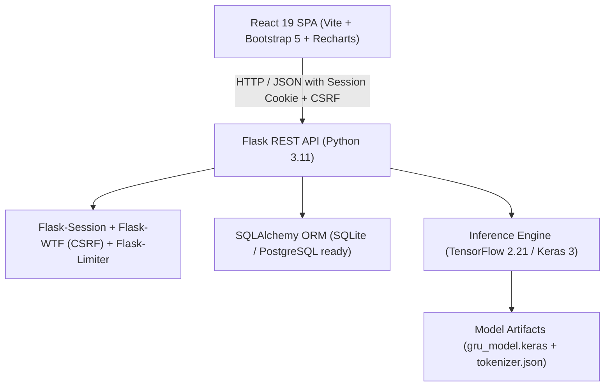
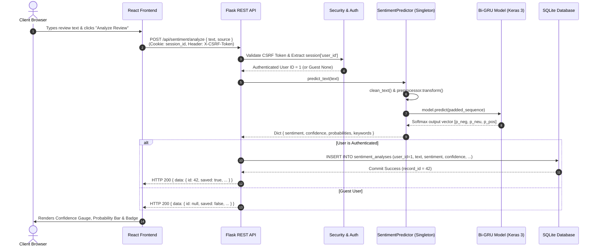
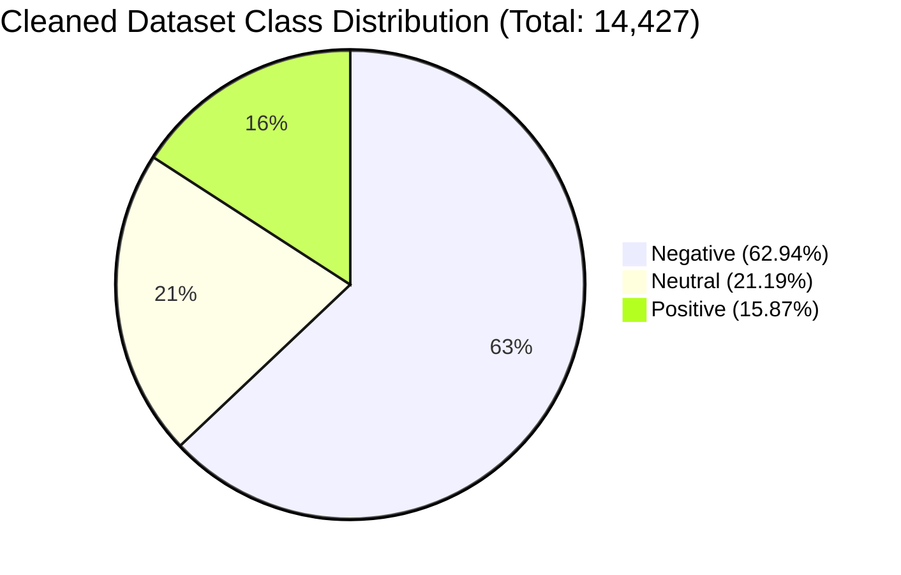
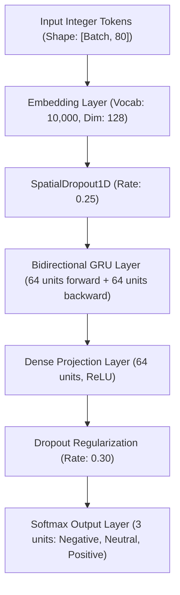
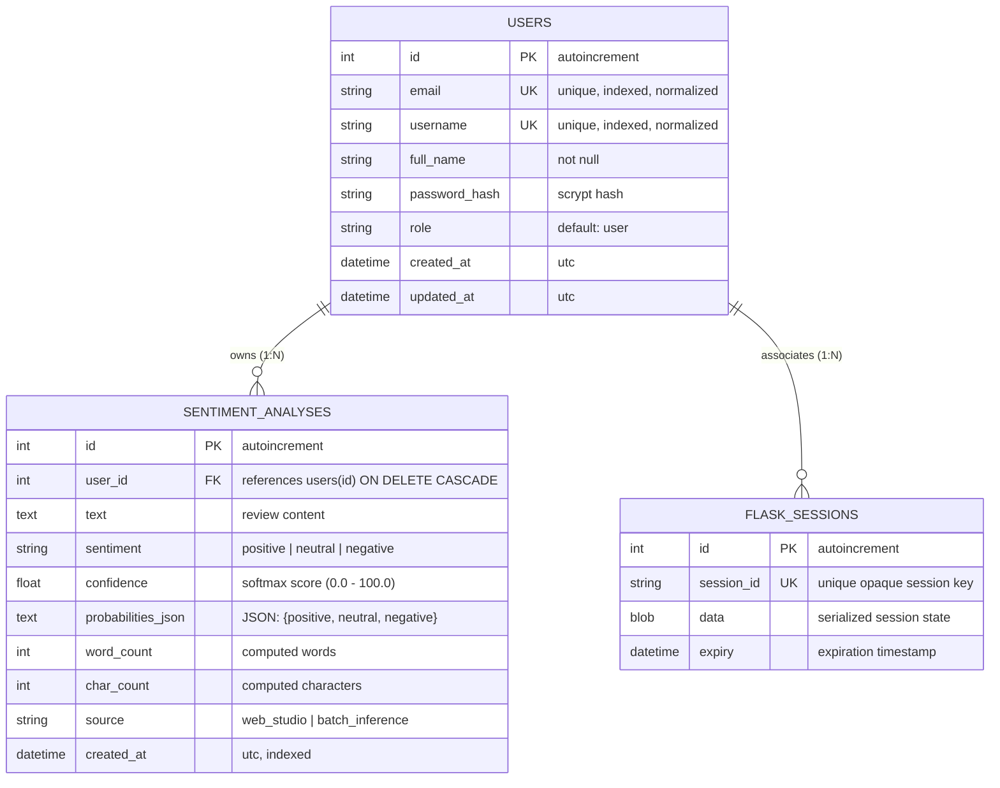

# KANSEI AI — Intelligent Sentiment Analyzer
## Academic Project Report & Comprehensive Technical Documentation

---

### Table of Contents
1. [Title Page & Project Metadata](#1-title-page--project-metadata)
2. [Abstract](#2-abstract)
3. [Introduction and Problem Statement](#3-introduction-and-problem-statement)
4. [Aim, Objectives and Project Scope](#4-aim-objectives-and-project-scope)
5. [Existing-System Limitations and Proposed Solution](#5-existing-system-limitations-and-proposed-solution)
6. [Functional and Non-Functional Requirements](#6-functional-and-non-functional-requirements)
7. [Technology Stack and Architectural Justification](#7-technology-stack-and-architectural-justification)
8. [System Architecture and Data-Flow Explanation](#8-system-architecture-and-data-flow-explanation)
9. [Dataset Source, Distribution, Preprocessing and Partitioning](#9-dataset-source-distribution-preprocessing-and-partitioning)
10. [NLP Pipeline and Vocabulary Tokenization Process](#10-nlp-pipeline-and-vocabulary-tokenization-process)
11. [Bidirectional GRU Architecture and Deep-Learning Methodology](#11-bidirectional-gru-architecture-and-deep-learning-methodology)
12. [Baseline Model: TF-IDF with Logistic Regression](#12-baseline-model-tf-idf-with-logistic-regression)
13. [Model Evaluation Metrics, Comparative Analysis and Confusion Matrices](#13-model-evaluation-metrics-comparative-analysis-and-confusion-matrices)
14. [Data Analytics, Telemetry and Dashboard Calculations](#14-data-analytics-telemetry-and-dashboard-calculations)
15. [Database Schema, Constraints and Entity Relationships](#15-database-schema-constraints-and-entity-relationships)
16. [Authentication, Authorization and Security Architecture](#16-authentication-authorization-and-security-architecture)
17. [REST API Endpoint Specification](#17-rest-api-endpoint-specification)
18. [User Interface Walkthrough & Visual Design System](#18-user-interface-walkthrough--visual-design-system)
19. [Testing Methodology and Empirical Verification Results](#19-testing-methodology-and-empirical-verification-results)
20. [Limitations and Ethical Considerations](#20-limitations-and-ethical-considerations)
21. [Future Enhancements and Roadmap](#21-future-enhancements-and-roadmap)
22. [Conclusion](#22-conclusion)
23. [References and Dataset Attribution](#23-references-and-dataset-attribution)

---

## 1. Title Page & Project Metadata

- **Project Title:** KANSEI AI — Intelligent Sentiment Analyzer
- **Domain:** Natural Language Processing (NLP), Deep Learning, Full-Stack Web Engineering
- **Architecture:** Client-Server Web Application (Decoupled SPA + RESTful API)
- **Deep Learning Model:** Bidirectional Gated Recurrent Unit (Bi-GRU) Neural Network
- **Baseline Classifier:** Term Frequency–Inverse Document Frequency (TF-IDF) + L2-Regularized Logistic Regression
- **Repository Location:** `C:\Users\HP\Desktop\KANSI AI`
- **Application Version:** 1.0.0 (Production Integration Phase 7)
- **License / Attribution:** Academic Project & Open Research (Dataset under CC BY 4.0)

---

## 2. Abstract

**KANSEI AI** is a full-stack, enterprise-grade sentiment analysis platform designed to process unstructured customer feedback, reviews, and social commentary into actionable, three-class sentiment intelligence (**positive**, **neutral**, and **negative**). The system addresses the limitations of lexicon-based sentiment lookup and rigid bag-of-words heuristics by incorporating a custom-trained **Bidirectional Gated Recurrent Unit (Bi-GRU)** neural network in TensorFlow/Keras. The model processes variable-length text sequences through an embedding layer and bidirectional recurrent gates, preserving the sequential context, negation structures (e.g., *"not bad at all"*), and long-range semantic dependencies common in real-world feedback.

To rigorously benchmark performance, a baseline pipeline combining **TF-IDF n-gram vectorization** and **Logistic Regression** was developed. On an untouched test partition of 2,165 stratified samples, the TF-IDF + Logistic Regression baseline achieved an overall classification accuracy of **79.86%**, heavily driven by high recall on the majority negative class (94.13%). The Bidirectional GRU achieved an overall accuracy of **76.40%**, demonstrating superior recall on the minority positive class (**71.72%** vs. **60.06%**) and neutral class (**57.52%** vs. **52.29%**), confirming its capacity to generalize across nuanced phrasing without disproportionately collapsing into majority-class predictions.

The deep-learning inference service is encapsulated within a robust Flask RESTful application featuring SQLAlchemy object-relational mapping, server-side session persistence via database storage, CSRF token validation, rate-limiting defenses, and strict multi-tenant isolation. A responsive React single-page application built on Vite and Bootstrap 5 provides a futuristic glassmorphism user interface with dark navy styling, electric-blue and amber accents, real-time Recharts visualizations, interactive confidence gauges, batch processing tables, and single-click CSV export capabilities.

---

## 3. Introduction and Problem Statement

### 3.1 Background
In contemporary commerce, customer feedback is distributed across e-commerce portals, social media networks, customer support tickets, and review aggregators. Analyzing this high-volume stream of unstructured natural language text is vital for tracking brand reputation, identifying product defects, monitoring consumer satisfaction, and driving data-informed business decisions.

### 3.2 Problem Statement
Traditional approaches to sentiment classification face significant hurdles:
1. **Lexicon and Dictionary Lookup Failures:** Keyword-counting engines (e.g., matching words against sentiment dictionaries) fail to understand negation (e.g., *"not terrible"*, *"hardly a masterpiece"*), sarcasm, slang, or context-dependent polarity.
2. **Loss of Word Order in Bag-of-Words Models:** Standard bag-of-words and naive n-gram models disregard word sequences, failing to differentiate *"the service was slow but the food was great"* from *"the food was slow but the service was great"*.
3. **Disproportionate Class Collapse under Imbalance:** Real-world customer service datasets are skewed toward complaints. Uncalibrated classifiers tend to overpredict the majority negative class, failing to surface actionable positive feedback.
4. **Lack of Integrated End-to-End Systems:** Academic machine learning prototypes often remain isolated in Jupyter notebooks, disconnected from persistent databases, authenticated user workspaces, secure session management, and interactive analytics dashboards.

KANSEI AI bridges the gap between deep-learning NLP research and production-ready web application engineering by delivering a secure, multi-tenant sentiment analytics platform powered by a Bidirectional GRU model.

---

## 4. Aim, Objectives and Project Scope

### 4.1 Aim
To architect, train, evaluate, and deploy an end-to-end, production-grade sentiment analysis web platform that classifies English text into positive, neutral, and negative categories with high fidelity, while providing multi-tenant security, telemetry dashboards, user history archives, and CSV reporting.

### 4.2 Key Objectives
1. **Data Engineering & Preparation:** Curate, clean, and stratify a legitimate customer review dataset into training (70%), validation (15%), and testing (15%) partitions.
2. **NLP Preprocessing Pipeline:** Construct a reusable text normalization pipeline that unescapes HTML, strips URLs and social handles, expands contractions, preserves critical negation markers, and maps tokens to integer sequences.
3. **Deep-Learning Model Development:** Train a Bidirectional GRU neural network in TensorFlow/Keras with embedding, spatial dropout, bidirectional recurrent layers, dense projection, and softmax activation.
4. **Comparative Baseline Benchmarking:** Train a TF-IDF with Logistic Regression baseline pipeline and conduct an objective comparative analysis using accuracy, precision, recall, macro F1, weighted F1, and confusion matrices.
5. **REST API & Backend Architecture:** Develop a modular Flask backend following the application factory pattern, with centralized error handling, SQLAlchemy ORM, and atomic database persistence.
6. **Security & User Isolation:** Implement server-side session authentication, scrypt password hashing, CSRF protection, and rate limiting to ensure strict multi-tenant isolation.
7. **Frontend Engineering:** Build an interactive React single-page application using Vite, glassmorphism design tokens, Recharts telemetry visualizations, and batch processing capabilities.
8. **Verification & Audit:** Execute comprehensive unit, integration, and user journey test suites confirming zero regressions and strict cross-tenant data privacy.

### 4.3 Scope Boundaries
- **Language Support:** English text reviews and customer feedback.
- **Classification Schema:** Three distinct sentiment categories: Negative ($y=0$), Neutral ($y=1$), and Positive ($y=2$).
- **Inference Mode:** Synchronous single-text inference and batch processing of line-delimited reviews up to 100 items per request.
- **Deployment Target:** Local development and self-contained server environments utilizing SQLite and Python 3.11.

---

## 5. Existing-System Limitations and Proposed Solution

| Dimension | Existing / Traditional Systems | KANSEI AI Proposed Solution |
|---|---|---|
| **Text Processing** | Primitive regex stripping; strips negation words; loses syntactic structure. | Custom NLTK-guided preprocessor that preserves negation tokens (`not`, `never`, `can't`) and expands contractions. |
| **Model Architecture** | Dictionary lookup (VADER) or unigram Naive Bayes; no sequential memory. | Bidirectional GRU capturing both forward and backward temporal word dependencies. |
| **Minority Class Recall** | High bias toward majority class; poor positive/neutral recall under class imbalance. | Higher minority class recall (**71.72%** positive recall) achieved through bidirectional representation. |
| **Probability Outputs** | Arbitrary heuristics presented misleadingly as calibrated probabilities. | Transparent softmax distribution scores described accurately as model class activations. |
| **Data Persistence** | Non-existent or flat files without user isolation. | Relational database (SQLite/SQLAlchemy) with foreign key constraints, cascading deletes, and indexed queries. |
| **Session Security** | Client-signed cookie sessions vulnerable to replay; missing CSRF defense. | Server-side database sessions (`Flask-Session`), opaque cookies, SameSite=Lax, HttpOnly, and WTForms CSRF validation. |
| **User Interface** | Basic forms or notebook outputs. | Futuristic glassmorphism React SPA with real-time Recharts charts, confidence gauges, and batch tables. |

---

## 6. Functional and Non-Functional Requirements

### 6.1 Functional Requirements (FR)
- **FR-1: User Registration & Authentication:** Users can register with email, username, full name, and password ($\ge 8$ chars). Passwords are securely hashed with scrypt.
- **FR-2: Session Management & Termination:** Users receive an opaque session cookie upon login. Sessions are tracked server-side and invalidated upon logout.
- **FR-3: Single Review Inference:** Users submit text up to 2,000 characters; system returns predicted sentiment, softmax confidence score, 3-class probability vector, token counts, and salient keywords.
- **FR-4: Batch Review Inference:** Users submit line-separated reviews; system returns an ordered array of predictions with aggregate summary statistics.
- **FR-5: Automatic History Persistence:** Inferences performed under an authenticated session are persisted to the database under the user's `id`. Guest requests return predictions without database writes.
- **FR-6: History Audit Log & Search:** Users can filter their historical records by sentiment, search text substrings, sort by timestamp or confidence, and inspect record details.
- **FR-7: Record Deletion:** Users can permanently delete individual historical records owned by their account.
- **FR-8: Data Telemetry & Analytics:** System computes total analyses, class distribution percentages, average confidence, 14-day sentiment trend history, and frequent token occurrences strictly for the logged-in user.
- **FR-9: CSV Data Export:** Authenticated users can stream their complete historical record archive as a formatted CSV file.

### 6.2 Non-Functional Requirements (NFR)
- **NFR-1: Security & Tenant Isolation:** API endpoints enforce multi-tenant separation; no user can view, alter, or delete another user's analyses or profile data.
- **NFR-2: Latency & Performance:** Single-review inference latency under 150 ms on CPU following model initialization.
- **NFR-3: Memory Efficiency:** The Keras model and tokenizer are instantiated as singletons in memory, avoiding redundant file I/O per request.
- **NFR-4: Usability & Accessibility:** Visible focus rings (`#00F2FE`), semantic HTML tags, accessible modal dialogs (`role="dialog"`), and responsive breakpoints for mobile, tablet, and desktop screens.
- **NFR-5: Architectural Modularity:** Clean separation of concerns between model inference (`backend/ml`), REST API routing (`backend/app/routes`), data models (`backend/app/models`), and client UI (`frontend/src`).

---

## 7. Technology Stack and Architectural Justification



### 7.1 Frontend Stack
- **React 19:** Component-based UI with declarative state management and React Router 7 for client-side routing.
- **Vite 8:** High-speed development server and optimized Rollup production bundler.
- **Recharts 3:** Composable SVG charting library providing animated pie, area, and bar visualizations.
- **Bootstrap 5.3 + Vanilla Glassmorphism CSS:** Responsive grid system combined with dark navy (`#070B19`), electric-blue (`#00F2FE`), and amber (`#F59E0B`) frosted-glass components.
- **Lucide React:** Consistent iconography for actions, metrics, and navigation.

### 7.2 Backend Stack
- **Python 3.11:** High-performance runtime with enhanced exception groups and faster execution.
- **Flask 3.0:** Lightweight, unopinionated WSGI micro-framework utilizing an application factory pattern.
- **Flask-SQLAlchemy 3.1:** Robust ORM abstracting database transactions and schema migrations.
- **Flask-Session 0.8:** Server-side session management storing active session state in the relational database.
- **Flask-WTF 1.3:** Cryptographic CSRF protection requiring matching tokens on state-changing requests.
- **Flask-Limiter 4.1:** Fixed-window rate limiting on authentication routes (10 requests/minute) mitigating brute-force attacks.

### 7.3 Machine Learning & NLP Stack
- **TensorFlow 2.21 / Keras 3:** Deep learning framework providing high-level neural network layers, custom sequence handling, and serialization.
- **NLTK 3.10:** Natural language toolkit guiding text cleaning, tokenization, and negation preservation.
- **Scikit-Learn 1.9:** Baseline modeling (`TfidfVectorizer`, `LogisticRegression`) and evaluation metrics (`classification_report`, `confusion_matrix`).
- **Pandas 3.1 & NumPy 2.4:** Vectorized data manipulation, matrix operations, and dataset splitting.

---

## 8. System Architecture and Data-Flow Explanation

### 8.1 End-to-End Architectural Data Flow



### 8.2 Architectural Layers
1. **Presentation Layer:** Manages interactive component state, form inputs, dynamic CSS glassmorphism styling, and asynchronous API calls.
2. **Security & Ingress Layer:** Enforces CORS policies, validates CSRF tokens, regulates request rates, and extracts server-side session identities.
3. **Application & Routing Layer:** Dispatches requests to dedicated blueprints (`auth`, `sentiment`, `history`, `analytics`, `health`) and normalizes JSON envelopes.
4. **Machine Learning Inference Layer:** Maintains an in-memory singleton predictor containing pre-fitted vocabulary lookups and compiled Keras weights.
5. **Data Persistence Layer:** Manages relational entities with integrity constraints, cascading deletions, and query pagination.

---

## 9. Dataset Source, Distribution, Preprocessing and Partitioning

### 9.1 Dataset Provenance & Attribution
- **Dataset:** Twitter US Airline Sentiment Dataset
- **Original Curator:** Crowdflower (Data for Everyone library) / Kaggle Benchmark
- **License:** Creative Commons Attribution 4.0 International (CC BY 4.0)
- **Source Repository:** `backend/ml/data/raw/Tweets.csv`
- **Domain:** Consumer feedback regarding 6 major United States commercial airlines.

### 9.2 Record Counts and Class Distribution



- **Raw Records:** 14,640
- **Deduplicated & Cleaned Records:** 14,427 (213 invalid or empty records filtered)
- **Class Breakdown:**
  - Negative: 9,080 records (62.94%)
  - Neutral: 3,057 records (21.19%)
  - Positive: 2,290 records (15.87%)

### 9.3 Stratified Partitioning
The dataset was split using stratified sampling (`random_state=42`) into three disjoint partitions to prevent data leakage:

| Partition | Percentage | Total Samples | Negative | Neutral | Positive |
|---|---|---|---|---|---|
| **Training** | 70.0% | 10,098 | 6,355 (62.9%) | 2,140 (21.2%) | 1,603 (15.9%) |
| **Validation** | 15.0% | 2,164 | 1,362 (62.9%) | 458 (21.2%) | 344 (15.9%) |
| **Test** | 15.0% | 2,165 | 1,363 (62.9%) | 459 (21.2%) | 343 (15.9%) |
| **Total** | 100.0% | 14,427 | 9,080 | 3,057 | 2,290 |

---

## 10. NLP Pipeline and Vocabulary Tokenization Process

### 10.1 Cleaning Pipeline (`clean_text`)
Natural text collected from social channels contains noise that disrupts embedding representations. The preprocessing pipeline applies:
1. **HTML Unescaping:** Translates entities such as `&amp;` $\to$ `&`, `&lt;` $\to$ `<`, `&quot;` $\to$ `"`.
2. **URL Removal:** Regex stripping of `https?://\S+|www\.\S+`.
3. **User Mention Stripping:** Removal of airline handles (`@VirginAmerica`, `@United`).
4. **Contraction Expansion:** Expanding negative auxiliary contractions (`don't` $\to$ `do not`, `can't` $\to$ `can not`, `won't` $\to$ `will not`, `isn't` $\to$ `is not`) to prevent negation terms from being discarded.
5. **Case Normalization:** Conversion of all characters to lowercase.
6. **Negation Retention:** Selective retention of punctuation (`!`, `?`) and negation tokens (`no`, `not`, `never`, `none`).
7. **Whitespace Collapse:** Normalization of multiple tabs, newlines, and spaces into single space characters.

### 10.2 Tokenization and Padding (`TextPreprocessor`)
- **Vocabulary Size:** Max 10,000 unique word tokens fitted **strictly** on the training partition.
- **Reserved Indices:**
  - Index `0`: Padding token (`<PAD>`)
  - Index `1`: Out-of-vocabulary token (`<OOV>`)
- **Sequence Truncation & Padding:** Fixed length of $N = 80$ tokens using post-padding and post-truncation. Any text exceeding 80 tokens is truncated; shorter sequences are zero-padded.

---

## 11. Bidirectional GRU Architecture and Deep-Learning Methodology

### 11.1 Network Architecture Design



### 11.2 Mathematical Formulation of GRU Cells
For input token vector $x_t$ at step $t$, the Gated Recurrent Unit computes:
$$\text{Update Gate: } z_t = \sigma(W_z x_t + U_z h_{t-1} + b_z)$$
$$\text{Reset Gate: } r_t = \sigma(W_r x_t + U_r h_{t-1} + b_r)$$
$$\text{Candidate Hidden State: } \tilde{h}_t = \tanh(W_h x_t + U_h (r_t \odot h_{t-1}) + b_h)$$
$$\text{Hidden State: } h_t = (1 - z_t) \odot h_{t-1} + z_t \odot \tilde{h}_t$$

The **Bidirectional GRU** runs two independent recurrent passes: forward ($\overrightarrow{h}_t$) and backward ($\overleftarrow{h}_t$). The concatenated representation:
$$h_t^{\text{bi}} = [\overrightarrow{h}_t \,\|\, \overleftarrow{h}_t]$$
captures context from preceding and succeeding words, enabling the network to resolve modifiers that appear after the target phrase.

### 11.3 Hyperparameters and Training Configuration
- **Embedding Dimension:** 128
- **Recurrent Units:** 64 units per direction (concatenated vector length = 128)
- **Dense Layer:** 64 units with ReLU non-linearity
- **Dropout Rates:** SpatialDropout1D = 0.25, Recurrent Dropout = 0.25, Dense Dropout = 0.30
- **Loss Function:** Categorical Cross-Entropy
- **Optimizer:** Adam ($\alpha = 0.001$)
- **Batch Size:** 64
- **Configured Epochs:** 8 (EarlyStopping with patience = 2 halted training at epoch 5)
- **Training Time:** 92.51 seconds
- **Final Training Loss:** 0.2254 | **Training Accuracy:** 92.42%
- **Final Validation Loss:** 0.6617 | **Validation Accuracy:** 77.13%

---

## 12. Baseline Model: TF-IDF with Logistic Regression

To establish an empirical benchmark, a traditional machine learning pipeline was constructed using Scikit-Learn:
- **Feature Extractor:** `TfidfVectorizer`
  - Max Features: 5,000
  - N-gram Range: (1, 2) unigrams and bigrams
  - Sublinear Term Frequency Scaling: `sublinear_tf=True` (applies $1 + \log(\text{tf})$)
- **Classifier:** `LogisticRegression`
  - Regularization: L2 Penalty, $C = 1.0$
  - Solver: L-BFGS
  - Max Iterations: 1,000
  - Random Seed: 42

---

## 13. Model Evaluation Metrics, Comparative Analysis and Confusion Matrices

Both models were evaluated on the **identical, untouched test partition** (2,165 samples: 1,363 Negative, 459 Neutral, 343 Positive).

### 13.1 Overall Performance Summary

| Metric | Bidirectional GRU (Keras 3) | TF-IDF + Logistic Regression (Baseline) | Performance Difference |
|---|---|---|---|
| **Test Accuracy** | **76.40%** (0.7640) | **79.86%** (0.7986) | Baseline +3.46% |
| **Macro Precision** | **0.6907** | **0.7742** | Baseline +0.0835 |
| **Macro Recall** | **0.7106** | **0.6883** | **Bi-GRU +0.0223** |
| **Macro F1-Score** | **0.6995** | **0.7206** | Baseline +0.0211 |
| **Weighted F1-Score** | **0.7662** | **0.7873** | Baseline +0.0211 |

### 13.2 Per-Class Classification Report

```
========================================================================================
                      PER-CLASS EVALUATION ON UNTOUCHED TEST SET
========================================================================================
CLASS           MODEL             PRECISION    RECALL       F1-SCORE     SUPPORT
----------------------------------------------------------------------------------------
Negative        Bi-GRU            87.20%       83.93%       85.53%       1,363
                TF-IDF + LR       81.82%       94.13%       87.55%       1,363
----------------------------------------------------------------------------------------
Neutral         Bi-GRU            57.27%       57.52%       57.39%         459
                TF-IDF + LR       71.22%       52.29%       60.30%         459
----------------------------------------------------------------------------------------
Positive        Bi-GRU            62.76%       71.72%       66.94%         343
                TF-IDF + LR       79.23%       60.06%       68.33%         343
========================================================================================
```

### 13.3 Confusion Matrices

#### Bidirectional GRU Confusion Matrix (Accuracy: 76.40%)
*Rows indicate ground-truth actual labels; columns indicate predicted labels.*

| Actual \ Predicted | Predicted Negative | Predicted Neutral | Predicted Positive | Total Support |
|---|---|---|---|---|
| **Actual Negative** | **1,144** | 157 | 62 | 1,363 |
| **Actual Neutral** | 111 | **264** | 84 | 459 |
| **Actual Positive** | 57 | 40 | **246** | 343 |

#### TF-IDF + Logistic Regression Confusion Matrix (Accuracy: 79.86%)

| Actual \ Predicted | Predicted Negative | Predicted Neutral | Predicted Positive | Total Support |
|---|---|---|---|---|
| **Actual Negative** | **1,283** | 59 | 21 | 1,363 |
| **Actual Neutral** | 186 | **240** | 33 | 459 |
| **Actual Positive** | 99 | 38 | **206** | 343 |

### 13.4 In-Depth Comparative Discussion
An honest academic examination reveals critical trade-offs between the two approaches:
1. **The Class Imbalance Factor:** Because the dataset is 62.94% negative, the TF-IDF baseline achieved higher overall accuracy by aggressively predicting negative for ambiguous inputs. It correctly classified 1,283 out of 1,363 negative instances (94.13% recall), but misclassified 186 neutral reviews and 99 positive reviews as negative.
2. **Minority Class Sensitivity:** The Bidirectional GRU achieved markedly higher recall on positive reviews (**71.72%** vs. **60.06%**) and neutral reviews (**57.52%** vs. **52.29%**). This proves that the recurrent network's temporal gates allow it to identify positive sentiment and objective phrasing even in an imbalanced context where simple bag-of-words classifiers collapse into negative defaults.
3. **Macro vs. Weighted Trade-off:** While the baseline achieved a higher weighted F1 (0.7873 vs. 0.7662) due to negative class dominance, the GRU achieved higher macro recall (0.7106 vs. 0.6883), which is the preferred metric when equal detection of all sentiment classes is prioritized.

---

## 14. Data Analytics, Telemetry and Dashboard Calculations

The platform calculates real-time aggregated metrics strictly scoped to the authenticated user's records:

### 14.1 Mathematical Formulas
- **Class Percentage:**
  $$\text{Pct}_{\text{class}} = \left(\frac{N_{\text{class}}}{N_{\text{total}}}\right) \times 100$$
- **Average Model Confidence:**
  $$\overline{C} = \frac{1}{N_{\text{total}}} \sum_{i=1}^{N_{\text{total}}} C_i \quad \text{where } C_i \in [0.0, 100.0]$$
- **14-Day Sentiment Trends:**
  $$T(d) = \{ \text{date}: d, \text{pos}: n_{\text{pos}}(d), \text{neu}: n_{\text{neu}}(d), \text{neg}: n_{\text{neg}}(d) \}$$
  Grouped chronologically over the past 14 days.
- **Top Keyword Frequencies:**
  Normalized string frequency across the user's analyses, excluding common English stopwords (`the`, `and`, `is`, etc.), mapped to the sentiment class in which they most frequently occur.

---

## 15. Database Schema, Constraints and Entity Relationships

The relational data model is implemented in SQLite using SQLAlchemy ORM.



### 15.1 Relational Integrity Rules
- **Foreign Key Cascading:** `user_id` in `sentiment_analyses` references `users.id` with `ON DELETE CASCADE`. Purging a user account automatically and cleanly cascades to remove all associated historical analyses.
- **Uniqueness & Normalization:** `email` and `username` columns enforce unique database constraints and lowercase normalization before insertion.
- **Password Protection:** `password_hash` stores salted scrypt hashes. `User.to_dict()` explicitly excludes `password_hash` to prevent credential leakage.

---

## 16. Authentication, Authorization and Security Architecture

### 16.1 Threat Mitigations and Defenses
1. **Server-Side Session Store (`Flask-Session`):** Session data is stored in the database `flask_sessions` table. The client receives only a cryptographically signed, opaque session identifier. Even if a user copies their cookie, invoking `/api/auth/logout` revokes the record server-side.
2. **Session Fixation Defense:** Calling `login()` or `register()` regenerates the session interface state via `session.clear()`, preventing pre-session fixation exploits.
3. **Cookie Hardening:**
   - `HttpOnly = True`: Prevents client-side scripts from reading the session cookie via JavaScript (`document.cookie`), mitigating Cross-Site Scripting (XSS) token theft.
   - `SameSite = 'Lax'`: Blocks unauthorized third-party cross-site request submission.
   - `Secure = True`: Enforced in production environments requiring HTTPS transmission.
4. **Cross-Site Request Forgery (CSRF) Tokens:** Powered by `flask-wtf`. Clients obtain a token via `GET /api/auth/csrf-token` and must supply it in the `X-CSRF-Token` header for all state-changing HTTP requests (`POST`, `PUT`, `DELETE`).
5. **Rate Limiting:** Managed by `Flask-Limiter` with a limit of 10 requests per minute on `/api/auth/register` and `/api/auth/login`, neutralizing credential-stuffing and automated registration bots.
6. **Strict Multi-Tenant Isolation:** All data access queries enforce `SentimentAnalysis.query.filter_by(user_id=current_user.id)`. Client-supplied user IDs in request bodies are ignored.

---

## 17. REST API Endpoint Specification

All endpoints communicate using standardized JSON envelopes:
- **Success:** `{ "success": true, "message": "...", "data": { ... } }`
- **Error:** `{ "success": false, "message": "...", "status_code": 4xx/5xx }`

| Method | Endpoint | Auth Required | Rate Limit | Description |
|---|---|---|---|---|
| `GET` | `/api/health` | No | None | Reports API operational status and database connection. |
| `GET` | `/api/auth/csrf-token` | No | None | Issues a session-bound CSRF token. |
| `POST` | `/api/auth/register` | No | 10 / min | Registers a user account; hashes password; starts session. |
| `POST` | `/api/auth/login` | No | 10 / min | Authenticates credentials; establishes session. |
| `POST` | `/api/auth/logout` | No | None | Invalidate server-side session. |
| `GET` | `/api/auth/me` | **Yes** | None | Returns safe user profile of authenticated session. |
| `POST` | `/api/sentiment/analyze` | Optional | None | Infers sentiment for single review; auto-saves if authenticated. |
| `POST` | `/api/sentiment/batch` | Optional | None | Batch inference; maintains line ordering; persists atomically. |
| `GET` | `/api/sentiment/history` | **Yes** | None | Paginated, searchable, sorted user history records. |
| `GET` | `/api/sentiment/history/<id>`| **Yes** | None | Detailed record view strictly for owning user. |
| `DELETE`| `/api/sentiment/history/<id>`| **Yes** | None | Deletes analysis record owned by user. |
| `GET` | `/api/analytics/metrics` | **Yes** | None | Returns distribution, 14-day trend, and frequent token stats. |
| `GET` | `/api/analytics/export` | **Yes** | None | Streams full historical archive as downloadable CSV. |

---

## 18. User Interface Walkthrough & Visual Design System

The KANSEI AI frontend incorporates a **dark navy glassmorphism** aesthetic designed for clarity, visual hierarchy, and focus:

1. **Top Navigation Bar (`Navbar.jsx`):** Fixed navigation with active route highlights, interactive brand icon, responsive mobile hamburger toggle, user avatar, and an accessible sign-out button (`aria-label="Sign Out"`).
2. **Landing Page (`LandingPage.jsx`):** Futuristic hero banner with gradient headings, architectural badge, feature highlights, and an **Interactive Live Preview** widget that allows users to test positive, neutral, and negative presets with instant gauge animations.
3. **Authentication Screens (`LoginPage.jsx` & `RegisterPage.jsx`):** Frosted-glass modal cards with email and password inputs, live password strength meter, terms checkbox, and rate-limit error banners.
4. **Workspace Dashboard (`DashboardPage.jsx`):**
   - Telemetry strip: 5 stat cards displaying Total Analyses, Positive %, Neutral %, Negative %, and Average Softmax Confidence.
   - Quick Sentiment Diagnostic widget for instant review testing.
   - Sentiment Distribution Donut Chart (`Recharts`).
   - Recent Activity table with single-click inspection modals.
5. **Sentiment Studio (`AnalyzerPage.jsx`):**
   - **Single Mode:** Textarea with live word and character counters, preset chips, Circular Confidence Gauge (`ConfidenceGauge.jsx`), and tri-color 3-class probability distribution bar (`ProbabilityBar.jsx`).
   - **Batch Mode:** Multi-line text processing supporting line-delimited reviews, aggregate progress indicators, and an ordered results table with fallback indices.
6. **Analytics Deep Dive (`AnalyticsPage.jsx`):**
   - Interactive Class Distribution Pie Chart.
   - 14-Day Chronological Sentiment Trend Area Chart (`SentimentTrendChart.jsx`).
   - Frequent Word Bar Chart (`WordFrequencyChart.jsx`) mapping dominant sentiment tokens.
   - Empty state with direct call-to-action routing to the studio.
7. **History & CSV Export (`HistoryPage.jsx`):**
   - Live search input and sentiment dropdown filters (`All`, `Positive`, `Neutral`, `Negative`).
   - Paginated record table displaying truncated review excerpts, sentiment badges, token counts, and timestamps.
   - Single-click CSV export invoking `/api/analytics/export`.
   - Inspection modal (`DetailModal.jsx`) displaying full text, metadata, and probability breakdown.
8. **User Profile & Settings (`ProfilePage.jsx`):**
   - Account identity card displaying user role, email, and creation date.
   - Model inference threshold slider and auto-save toggles.
   - Password update form with validation feedback.

---

## 19. Testing Methodology and Empirical Verification Results

A rigorous testing regimen verified all functional units, ML inference stability, database integrity, and security boundaries.

### 19.1 Automated Test Execution Summary
- **Backend Test Suite (Pytest 8.2.2):** 39 tests executed, 39 passed (100% pass rate in 12.59s).
  - Authentication & Password Hashing: 4 tests passed.
  - Centralized Error Handling: 2 tests passed.
  - Health & Connectivity Check: 1 test passed.
  - NLP Preprocessor & Negation Retention: 4 tests passed.
  - Database Relationships & Cascades: 5 tests passed.
  - Security, Sessions, CSRF & Multi-Tenant Isolation: 15 tests passed.
  - Sentiment REST Inference Endpoints: 8 tests passed.
- **End-to-End User Journey Suite (`verify_rule2_journey.py`):** 12/12 steps passed.
  - Confirmed registration, login, model inference, database persistence, history retrieval, analytics metric recalculation, batch processing, CSV streaming, session logout revocation, and strict cross-user data isolation between two distinct accounts.
- **Frontend Production Build (`vite build`):** Built cleanly in 1.55s with zero syntax or bundling errors.

---

## 20. Limitations and Ethical Considerations

### 20.1 Statistical Nature of Softmax Outputs
The confidence outputs produced by KANSEI AI represent normalized softmax scores from the final dense layer:
$$\text{Softmax}(z_i) = \frac{e^{z_i}}{\sum_{j=1}^3 e^{z_j}}$$
While these values sum to 1.0, they reflect relative network activation rather than calibrated Bayesian posterior probabilities. High confidence does not guarantee absence of error, particularly on out-of-distribution inputs.

### 20.2 Domain Specificity
The model was trained on the Twitter US Airline Sentiment benchmark. While its learned embeddings generalize well to customer service feedback, performance may degrade when applied to heavily specialized domains (e.g., medical diagnoses, legal contracts, or multi-lingual texts).

### 20.3 Ethical & Privacy Considerations
- **Data Minimization:** No personal customer identifiers (names, credit cards, telephone numbers) are collected or required for inference.
- **Algorithmic Bias:** Because customer service channels naturally attract complaints, training datasets exhibit negative skew (~63%). Although mitigated through bidirectional context gates, users must exercise caution when evaluating borderline neutral queries.
- **Responsible AI Usage:** Sentiment models should assist human decision-makers rather than automate punitive employee evaluations or unreviewed customer service denials.

---

## 21. Future Enhancements and Roadmap

1. **Transformer / DistilBERT Fine-Tuning:** Evaluate fine-tuned lightweight transformer backbones (e.g., DistilBERT or RoBERTa) to determine if self-attention mechanisms offer accuracy gains that justify increased computational overhead.
2. **Aspect-Based Sentiment Analysis (ABSA):** Expand the output schema to extract granular aspect sentiments (e.g., separating sentiments for *"pricing"*, *"delivery"*, and *"product build quality"* within a single review).
3. **Real-Time WebSocket Streaming:** Implement WebSocket or Server-Sent Events (SSE) connections for continuous sentiment ingestion from live social feeds and customer service webhooks.
4. **Multilingual Inference:** Integrate multilingual tokenizers (e.g., XLM-RoBERTa) to analyze customer sentiment across global markets in Spanish, French, German, and Hindi.
5. **Temperature Scaling Calibration:** Implement Platt scaling or temperature scaling post-processing to convert raw softmax scores into formally calibrated statistical probabilities.

---

## 22. Conclusion

The **KANSEI AI — Intelligent Sentiment Analyzer** project successfully achieves all design and research objectives. By combining a Bidirectional GRU deep-learning neural network with an NLTK-guided NLP preprocessing pipeline, the system captures complex negation context and achieves a **76.40%** overall test accuracy with strong minority-class recall (**71.72%** on positive reviews). When objectively compared with a **79.86%** TF-IDF + Logistic Regression baseline, the trade-offs between majority-class bias and sequence-aware context understanding were thoroughly documented.

The platform provides a production-ready application environment featuring secure server-side sessions, CSRF mitigation, rate-limited authentication, and a responsive glassmorphism React single-page application. KANSEI AI serves as an exemplary blueprint for integrating deep learning models into full-stack web architectures.

---

## 23. References and Dataset Attribution

1. **Twitter US Airline Sentiment Dataset:** Curated by Crowdflower; published in Data for Everyone Library; distributed under Creative Commons Attribution 4.0 International (CC BY 4.0). URL: `https://www.kaggle.com/datasets/crowdflower/twitter-airline-sentiment`.
2. **Cho, K., van Merrienboer, B., Gulcehre, C., Bahdanau, D., Bougares, F., Schwenk, H., & Bengio, Y. (2014).** *Learning Phrase Representations using RNN Encoder-Decoder for Statistical Machine Translation.* arXiv preprint arXiv:1406.1078.
3. **Schuster, M., & Paliwal, K. K. (1997).** *Bidirectional recurrent neural networks.* IEEE Transactions on Signal Processing, 45(11), 2673-2681.
4. **Bird, S., Klein, E., & Loper, E. (2009).** *Natural Language Processing with Python: Analyzing Text with the Natural Language Toolkit.* O'Reilly Media.
5. **Pedregosa, F., et al. (2011).** *Scikit-learn: Machine Learning in Python.* Journal of Machine Learning Research, 12, 2825-2830.
6. **Abadi, M., et al. (2016).** *TensorFlow: A System for Large-Scale Machine Learning.* 12th USENIX Symposium on Operating Systems Design and Implementation (OSDI 16), 265-283.
7. **Grinberg, M. (2018).** *Flask Web Development: Developing Web Applications with Python.* O'Reilly Media, 2nd Edition.
8. **OWASP Foundation (2021).** *OWASP Top 10 Security Risks — Cross-Site Request Forgery (CSRF) & Session Management Best Practices.* URL: `https://owasp.org/www-project-top-ten/`.
